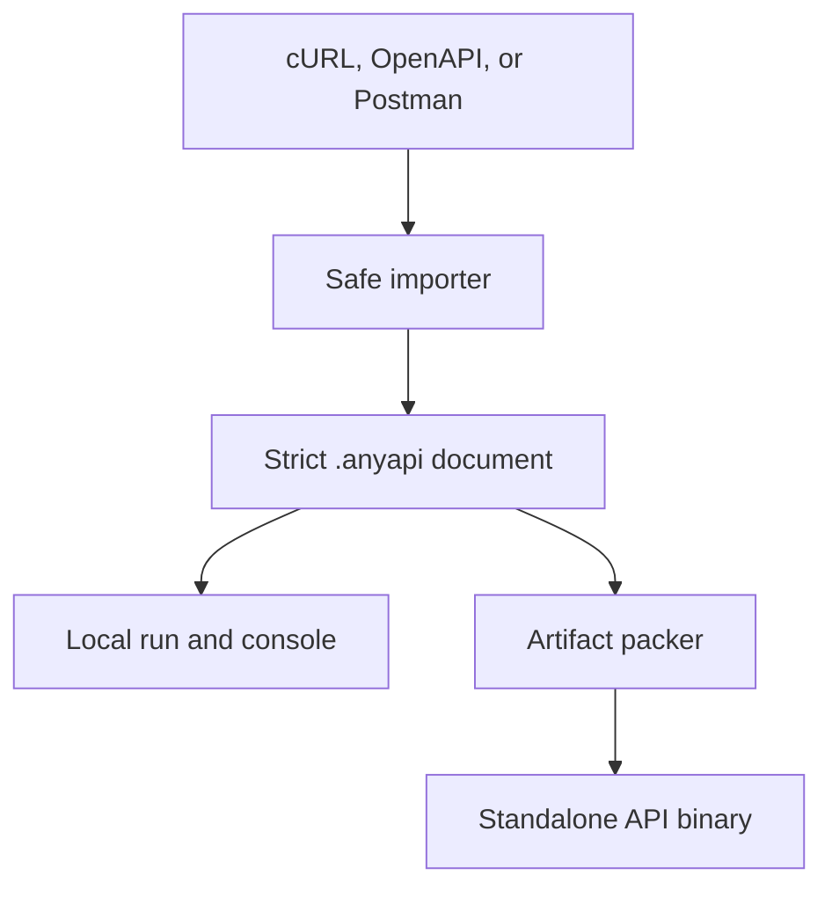
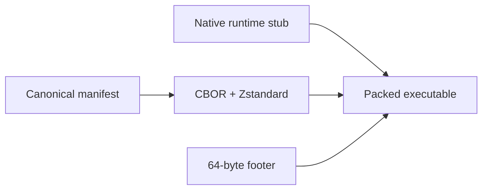

# Architecture

AnyAPI is one Go program with two startup paths. A clean release binary starts the builder. A packed binary detects and verifies its embedded manifest, then starts only the generated API runtime.

## Packages

| Package | Responsibility |
|---|---|
| `internal/importer` | Format detection, parsing, normalization, diagnostics, and secret redaction |
| `internal/model` | Versioned intermediate representation, normalization, and executable validation |
| `internal/specio` | Strict YAML decoding and permission-safe atomic writes |
| `internal/httpengine` | Request preparation, auth, bounded I/O, TLS policy, and retries |
| `internal/runtimecli` | Dynamic Cobra command tree embedded in generated CLIs |
| `internal/artifact` | Deterministic CBOR/Zstandard payloads, footer integrity, packing, and loading |
| `internal/target` | ELF, Mach-O, and PE target detection plus local runtime storage |
| `internal/console` | Interactive editing session, history, completion, selection, and undo/redo |
| `internal/credentials` | Environment and operating-system keyring integration |
| `internal/output` | Raw, JSON, YAML, table, dry-run, and file output |

## Import boundary

Importers never execute input. The cURL importer uses a purpose-built shell tokenizer and recognizes request-related arguments. It never invokes a shell, `curl`, Postman, or arbitrary scripts. Postman pre-request and test scripts are recorded as skipped diagnostics.

All importers produce the same typed document. Normalization creates stable names and ordering where ordering is not semantically significant. Diagnostics remain in `import.diagnostics` so a lossy decision stays visible after the original source is gone.

## Runtime boundary

The HTTP engine receives a document command plus explicit runtime values. It resolves a server and profile, validates scalar types, expands path parameters, builds the body, resolves authentication, and prepares an immutable request description. Dry-run output uses that description but redacts sensitive headers.

Network execution has bounded request and response memory, a default 30-second timeout, TLS 1.2 minimum, and retries only for idempotent methods and transient status codes.

## Artifact boundary

The packer refuses to pack an already-generated API binary. It validates the document, bounds runtime and payload sizes, writes to a same-directory temporary file, syncs it, and publishes it with replacement recovery for platforms that cannot rename over an existing file.

The payload digest detects corruption and uncoordinated modification. It is not a signature and does not establish publisher authenticity; release checksums or platform signing must provide that trust layer.

## Cross compilation

AnyAPI does not invoke a cloud builder. A cross-target artifact needs a clean AnyAPI runtime built for that target. `targets install` inspects the source file format and CPU architecture before storing it in the user's cache. `build --target` then attaches the same manifest format to that target runtime.

This avoids runtime code generation and keeps the generated command behavior identical across supported operating systems.
